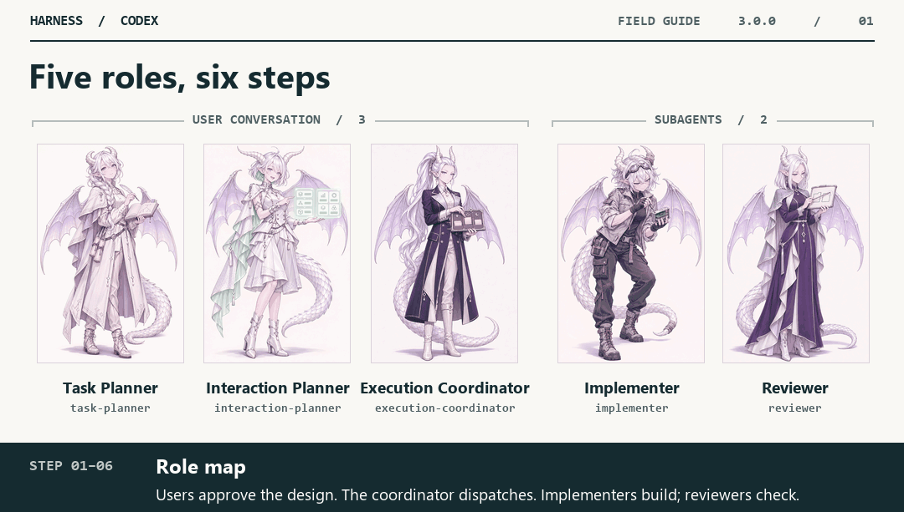
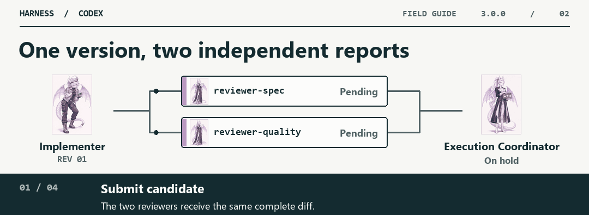

# Harness-AI-Lite · DeepSeek Harness

[简体中文](README.md) · **English**

Harness-AI-Lite is a DeepSeek Harness workspace plugin that organizes software development through Markdown files. It takes a feature from a requirements interview to a verifiable delivery: the user works out the design with three conversation roles, an implementer works within the authorized scope, and reviewers check the same version from two independent perspectives. When a new session takes over, it can find **what was decided, who still has write access to the task, and what may happen next.**



[Static role portraits and handoff map](docs/assets/roles-en.png) · [Install the plugin](#install-the-plugin) · [Quick start](#quick-start) · [Six-step workflow](#six-step-workflow) · [Execution and dual review](#execution-and-dual-review)

## Install the plugin

1. Open **Plugins → Add plugin** in **DeepSeek Harness Desktop for Windows**. The target host is `0.2.2-rc.5`.
2. Paste the GitHub URL below, confirm installation, and enable the plugin. Then open **Add Harness workspace** in the sidebar.

```text
https://github.com/xuzh0312/dsh-Harness-AI-Lite
```

You can also [download the ZIP](https://github.com/xuzh0312/dsh-Harness-AI-Lite/archive/refs/heads/main.zip), extract it, and enter the absolute path to the folder containing `package.json` in Add plugin. Both methods use the ready-to-run files in the repository.

The plugin UI follows the host's Chinese or English locale. The generated workspace template is in Simplified Chinese. Workspace setup requires the Windows desktop folder picker.

## Quick start

1. **Select four existing directories.** Under **Add Harness workspace**, select `harness`, `project`, `project/code`, and `test`. They can be on different drives. Point the code root directly to an existing repository. The code root belongs to the project area.
2. **Create the workspace and verify its paths.** The plugin fills in missing template files, preserves existing files, updates the [hot paths table](template/docs/paths.md), and registers `harness` as a workspace. If setup reports a warning, check the path table, directory permissions, and the sidebar entry before starting work.
3. **Open a new session.** Open the registered workspace and fill in the [project overview](template/README.md) with the purpose, users, scope, and template source. Record the source commit from this repository if available. Read the [architecture and boundaries](template/ARCHITECTURE.md) and the [model agreement](template/agents/MODELS.md). New sessions start in `harness`. The extra writable roots apply to DSH file tools. PowerShell and other subprocesses remain subject to the host's session working-directory sandbox, so verify permissions before running project checks.
4. **Start at the step you need.** Use the prompt below for a new project. To resume an existing feature, provide its ID, current records, and what you are asking the session to do.

```text
First read AGENTS.md and docs/paths.md under <actual Harness path>.
Goal: add “export the current filtered results” to an existing list.
Do only step 1. As Task Planner, interview me, then decide with me whether to research open-source references.
You may register the feature and write the interview and references in the project copy. Do not modify product code or run tests.
At handoff, tell me what is confirmed, what is missing, and which file to open next.
```

The [six takeover prompts](template/docs/runbooks/start-task-template.md) cover other starting points. To upgrade a deployed copy, back up its Harness and compare it against the original protocol version, source commit, or package checksum. **Merge only the protocol differences.** Do not replace the user's project overview, architecture, paths, plans, customized rules, or historical evidence with a clean template.

## Five roles

| Role | Who interacts with it | Responsibility and stopping point |
| --- | --- | --- |
| [Task Planner](template/agents/task-planner/AGENT.md) `task-planner` | User, in conversation | Steps 1, 2, 4, and 5: interview, open-source references, features and stack, project proposal, and implementation Plan. Another session may review the same version read-only. The planner cannot approve on the user's behalf or dispatch early implementation. |
| [Interaction Planner](template/agents/interaction-planner/AGENT.md) `interaction-planner` | User, in conversation | Step 3: use a real task to decide entry points, states, feedback, and recovery. When asked, dispatch an implementer to an authorized `test` location for a preview and collect user feedback. Return new features or stack changes to the Task Planner. |
| [Execution Coordinator](template/agents/execution-coordinator/AGENT.md) `execution-coordinator` | User, in conversation | Step 6: verify approved versions, authorized items, and active writers; dispatch work, manage rework, check evidence, and accept items and the overall feature. Cannot relax criteria or settle disputed findings unilaterally. |
| [Implementer](template/agents/implementer/AGENT.md) `implementer` | Dispatched by a conversation role | Two assignments: produce a simulated preview in `test`, or implement and self-check an item authorized through the coordinator. Return the full change, checks, and gaps. Do not approve your own work, dispatch reviewers, or start the next item. |
| [Reviewer](template/agents/reviewer/AGENT.md) `reviewer` | Dispatched by the conversation role requesting review | Read-only by default. `reviewer-spec` checks the requirements for omissions; `reviewer-quality` follows the diff through failure paths and regressions. They are **two independent instances of one role**. Each reports separately; neither edits the implementation or approval record. |

The first three roles may be taken in one session or handed to separate sessions. Reusing a role does not extend the assignment. The project model agreement governs only the two subagent roles. Before first dispatch, ask about model and reasoning-effort restrictions if there is no applicable answer; reuse it within its scope. If independent instances cannot be obtained under that agreement, report the blocker instead of calling the author's self-check a dual review.

## Six-step workflow

Paths below are relative to the deployed `harness/`. An `<ID>` looks like `PLAN-0001`. It may be reserved when the first formal record is authorized for writing, but **the implementation Plan is not created until step 5**. All stages reuse the same ID across sessions.

| Step and owner | Question to resolve | Handoff |
| --- | --- | --- |
| **1 · Requirements and references** · Task Planner | Who encounters what problem, and when? Ask one question that affects a decision at a time; record answers as you go. Decide with the user whether to research. For each reference, pin its version, license evidence, and the part worth borrowing. | `docs/specs/<ID>/interview.md` and `references.md` in the same directory. Record why research was skipped; “not investigated” does not mean “no candidates.” |
| **2 · Features and stack** · Task Planner | Use the two records and the existing implementation to agree on entry points, inputs, outputs, exceptions, and success conditions. Compare retaining the current stack with replacing it. | `docs/specs/<ID>/features-stack.md`. Distinguish confirmed choices from open questions. A confirmed candidate stack is not yet installed or in force. |
| **3 · UI/UX** · Interaction Planner | Read the preceding three documents and follow a user task through feedback, failure, and recovery. Create a preview only when needed and authorized. If the UI is unaffected, confirm the scope and reason with the user. | `docs/specs/<ID>/uiux.md`. Record the selected direction, design version, feedback, and scenarios still needing tests. Do not invent a mockup for a feature with no interface impact. |
| **4 · Project proposal** · Task Planner | Combine features, stack, and interaction decisions (or why UI/UX is not applicable) into an execution specification. Check that modules, data, interfaces, compatibility, and acceptance criteria fit together. | `docs/specs/<ID>.md`. Give observable outcomes stable IDs such as `AC-01`. Resolve major contradictions before splitting implementation items. |
| **5 · Implementation Plan** · Task Planner | Map criteria to items such as `PLAN-0001.01`. Specify dependencies, writable scope, per-item checks, and overall acceptance. Present the exact proposal and Plan versions together. | `docs/plans/active/<ID>.md`. Record the user's approval of that version pair and its basis, separately from the items authorized for implementation. Stop here if only planning was requested. |
| **6 · Execution and acceptance** · Execution Coordinator | Check the approved pair and implementation authorization. Dispatch one authorized implementation item at a time. Implementation, self-checks, independent dual review, and acceptance precede the next item. Finally check integration across items. | Continue in the same Plan. Record the reviewed version, evidence locations, rework, and next action. Outstanding unauthorized items keep the Plan in `active/`. |

Each stage document opens with a **handoff record**: step and version, input versions, what the user confirmed and on what basis, unresolved issues, current writer, and next action. When an upstream decision changes, mark the affected downstream items and pause their work. Do not redo unaffected work or apply an old approval to a new scope. See the [stage deliverables](template/docs/specs/README.md), [proposal template](template/docs/specs/TEMPLATE.md), and [Plan template](template/docs/plans/TEMPLATE.md).

## Worked example

**Example: add CSV export to an existing list.** The IDs, versions, and findings below illustrate the protocol. They are not a shipped project or actual test results.

| What the user says | What it means in practice |
| --- | --- |
| “Add an export.” | The Task Planner asks which rows the user needed after filtering the list last time. They want **all matching results**, not just the current page or the whole database. Step 2 defines column order, empty-result behavior, and reuse of the existing stack. |
| “I'd like to see it first.” | The Interaction Planner and user agree on the export control, empty-list feedback, and retry after a failed write. Only an authorized preview goes into `test`. A mockup can confirm copy and direction; it cannot prove that a correct file was written. |
| “The plan looks right. Do the export logic first.” | Suppose the user approves proposal v2 + Plan v1 and authorizes only `.01`, the export logic. For `AC-01`, supply two pages of matches and one filtered-out row. The file must contain both pages' matches, exclude that row, and preserve column order. `.02`, wiring up the UI, still needs authorization. |
| “The tests passed. Why isn't it accepted?” | In the example below, the spec reviewer advises a pass, but the quality reviewer finds a cleanup defect after a failed write. Both must confirm the revised version, and the coordinator still needs evidence that the user can retry successfully. |
| “Make an installer as well.” | This adds packaging authorization; establish the version and scope first. A successful build is not artifact acceptance, and producing a package does not authorize publication. |

## Execution and dual review



[Static four-panel sequence](docs/assets/review-en.png) · [Execution protocol](template/skills/subagent-driven-execution/SKILL.md) · [Review conclusions and disputes](template/agents/reviewer/AGENT.md)

1. **Freeze the version under review.** A fresh implementer handles each implementation item. The coordinator supplies two read-only instances with the same requirements, complete baseline-to-candidate diff, execution report, and original evidence. Neither reads the other's conclusion. If concurrency is limited, use two independent contexts sequentially and record that fact.
2. **Answer two separate questions.** Spec review asks whether the behavior matches what the user approved, including omissions and scope creep. Quality review asks how it can fail, which existing behavior might regress, and whether the checks could detect the error. Preserve each conclusion (recommend pass, rework required, or insufficient evidence) and its reviewed version.
3. **Do not combine reports from different revisions.** Prefer the original implementer and review pair for rework. Recheck affected behavior; both reviewers must confirm the same final version. If they still disagree, return the evidence for recheck before asking the user to adjudicate the specific finding. No ruling substitutes for a missing report, an unrun required check, or an unmet acceptance criterion.
4. **Passing every item is not the same as passing the feature.** Once all implementation items in the approved scope pass, dispatch a fresh pair to review the full specification, cross-item interfaces, regressions, and final evidence. Unauthorized items stay pending. Archive the Plan only after overall acceptance. Acceptance does not automatically commit, push, merge, package, or publish anything.

**An independent fix is not a shortcut for new features.** For example, fixing a leaked file handle under the existing export contract can use `TASK-0001` to record the symptom, reproduction, baseline, both independent reviews, and recheck. No invented feature proposal is needed. If the user instead asks for different export behavior, return to the appropriate planning step. Routine Q&A does not create a TASK. See [IDs and archiving](template/docs/plans/README.md).

## Three work areas

| Area | What belongs here | Common mistakes |
| --- | --- | --- |
| [`harness/`](template/) | Project overview, rules, roles, skills, stage materials, Plans, decisions, and the defect knowledge base. | A Plan names the location and version of evidence; do not fill it with raw logs, real data, or project prototypes. |
| [`project/code/`](seeds/project/code/) | Delivered product source, runtime resources, necessary dependency and build configuration, and entry points that ship with the software. | New tests, reproduction scripts, and packaging helpers default to `test`; preserve existing tests in their original locations. |
| [`test/`](seeds/test/README.md) | Test and tool source, mockups, data, raw logs, screenshots, ordinary builds, and check results. | Shareable source goes in `src/`; approved shareable designs go in `approved-designs/`. Sensitive or large files are ignored by default. A checksum identifies a version but is not a restorable backup. |
| [`project/installpark/`](seeds/project/installpark/) (part of `project`) | Only the final ZIP whose creation was explicitly authorized. | Do not store ordinary builds, intermediate files, or extracted contents here. Extract in a separate `test` location and verify launch or installation from the packaged entry point without relying on the source tree. |

In a deployed project, `harness`, the actual code root, and `test` are versioned separately; `installpark` is outside all three repositories. Link their versions through the same PLAN/TASK ID. Repository initialization or migration requires authorization. Without a commit, record the baseline and working-tree diff rather than inventing a SHA.

## Resuming across sessions

| Situation | How to resume |
| --- | --- |
| A new session knows only the feature ID | Open that feature's entry in [hot paths](template/docs/paths.md). Verify its handoff record, actual version, approval, authorization, and active writers. Do not scan the cold archive or infer completion from an old chat. |
| Two sessions want to write the same file | A file, Plan, or shared ID has one writer at a time. Hot paths, cold paths, the defect register, and the model agreement use an atomic `.lock` on the same actual copy. Do not break a lock on timeout. Confirm the previous writer and its commands have stopped or their writes have been isolated. |
| A selected design will be an acceptance reference | Before approval, first dispatch, and resuming implementation, retrieve the fixed version and required resources and verify the checksum. If it cannot be recovered, pause dependent items or ask the user to confirm independently testable written criteria. |
| A task finishes, is canceled, or needs reopening | Completed records and canceled records whose writers have stopped go to `completed/`. Keep evidence hot while active work depends on it. Move only the **index entry** to [cold paths](template/docs/paths-cold.md) when no active dependency remains; the original is not moved or deleted. Reopening does not restore revoked authorization. |
| A familiar defect returns | Reviewers use [bug-detect](template/skills/bug-detect/SKILL.md) to search by trigger and root cause, then propose reusing or reopening the BUG ID. The conversation role requesting review serializes updates to the [project defect register](template/docs/bugs.md). Keep suggested fixes separate from verified solutions. |

## Skills and references

In DSH, use `read` to load project skills by path. Dispatch with local `subagent` (Spawn) and follow the model agreement for inheriting the main session settings. The active profile determines which question tools are available. You can also ask directly in chat.

Roles explicitly load skills by path; runner auto-discovery is not required. Start from the [skill index](template/skills/README.md) or the [role handoff brief](template/agents/TASK_TEMPLATE.md).

| Skill | When to use it |
| --- | --- |
| [feature-plan](template/skills/feature-plan/SKILL.md) | Steps 1, 2, 4, and 5: interview from real experience, record reference choices, check feasibility, and map the specification to numbered items. |
| [tech-stack-plan](template/skills/tech-stack-plan/SKILL.md) | Compare candidate stacks in step 2. For initial activation or a change, the coordinator submits the complete authorized architecture diff for dual review. Only after the same reviewed candidate is applied unchanged and verified may dependent implementation begin. |
| [UIUX-design](template/skills/UIUX-design/SKILL.md) | Step 3: follow the user task through key states and recovery. When choosing motion, discuss strong, standard, or light motion. Use the [offline UI technique atlas](template/skills/UIUX-design/assets/index.md) to compare layout, motion, and materials, not as evidence of a real product test. |
| [subagent-driven-execution](template/skills/subagent-driven-execution/SKILL.md) | Step 6: dispatch an authorized item, run per-item dual review, manage rework, and complete overall acceptance and delivery. |
| [bug-detect](template/skills/bug-detect/SKILL.md) | When verifying a defect or rechecking a fix, search for matching root causes and distinguish new findings, recurrences, and issues still under investigation. |

The interview approach draws on GrillMe; item-by-item execution and independent review draw on Superpowers. Both are optional. Report rule conflicts or adoption problems in Issues without including sensitive project material. This project uses the [MIT license](LICENSE).

## Configuration and maintenance

Selected directories are recorded in `harness/.dsh/harness-workspace.json`. The host credential store saves a fingerprint. After moving directories, select them again in the plugin and verify `docs/paths.md`. Use the workspace menu to remove its sidebar entry. Deleting the path record prevents future sessions from receiving the extra write roots.

Run `npm test` from the repository root with Node.js 24 when maintaining the plugin. The tests use temporary directories and a simulated host.

[Historical DSH packages](https://github.com/xuzh0312/Harness-AI-Lite/blob/main/README.dsh.en.md#historical-packages)
